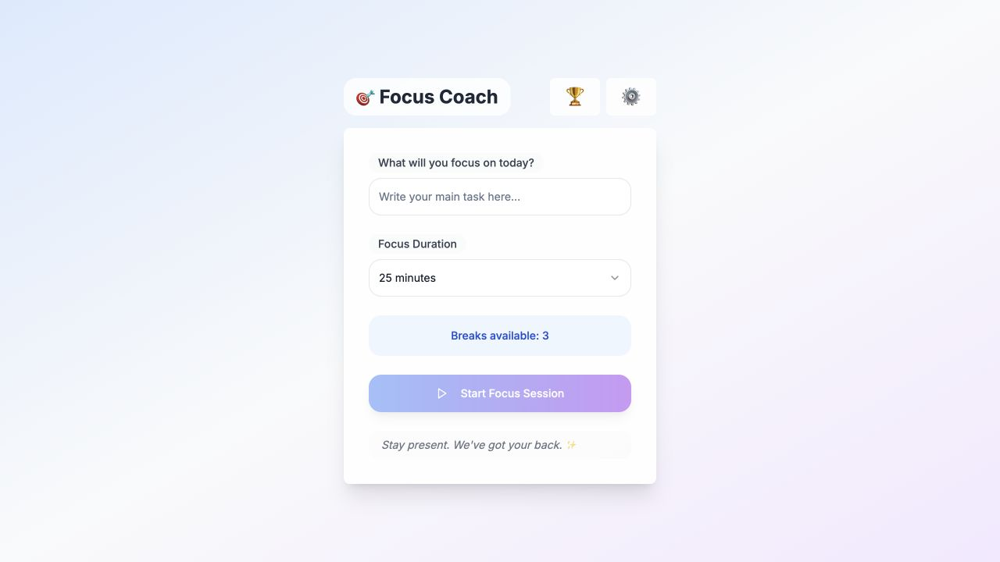
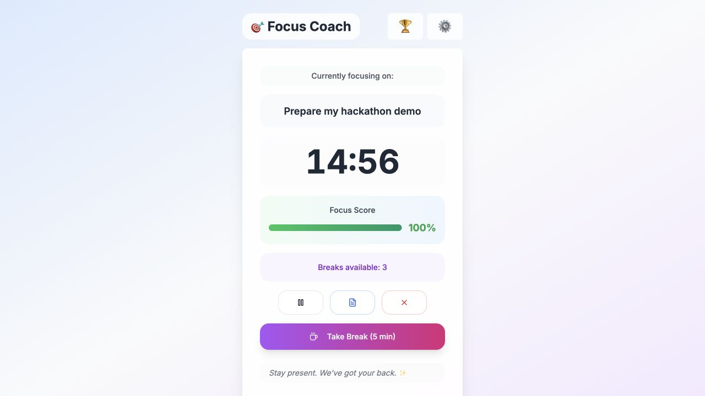

# 🎯 Focus Coach

**Stay present. We've got your back.**

A calmer workspace for choosing a task, staying focused, and taking time to recharge.

**[Try Focus Coach](https://v0-new-project-emcec5fbckx.vercel.app/)**

🏆 **Winner · UA Little Rock's 2025 AI and Mental Health Hackathon · $2,100 team award**

## The idea

Getting distracted is easy. Returning to the task should feel approachable.

Focus Coach brings task timers, supportive feedback, and wellness breaks into a simple routine: **choose one task → focus → pause and recharge**.

## Explore the demo

- **Task-based sessions** with a choice of focus durations.
- **A countdown and focus feedback** to keep the current task in view.
- **Five-minute breaks** for a more balanced work session.
- **A summarization panel** within the focus workspace.
- **Settings and a leaderboard** exploring personalization and social encouragement.

See an active session

## Team and recognition

Focus Coach won UA Little Rock's **2025 AI and Mental Health Hackathon**, earning a **$2,100 team award**. [Read the university's coverage](https://ualr.edu/news/2025/08/07/mental-health-ai-hackathon/).

The project brought together **Anay Pandit, James Dempsey, Fahad Malallah, Duron Huggins, Aiden Behler, Elliot Estes, and Leelin Johnson** across development, research, and presentation. Anay contributed to development and presented the demonstration.

The team used **Vercel v0, ChatGPT, Claude, and Gamma** during prototyping and presentation preparation.

*This repository showcases the hackathon prototype and its live demo. Application source is not included, and the demo's AI and browser-wide blocking integrations have not been established.*
