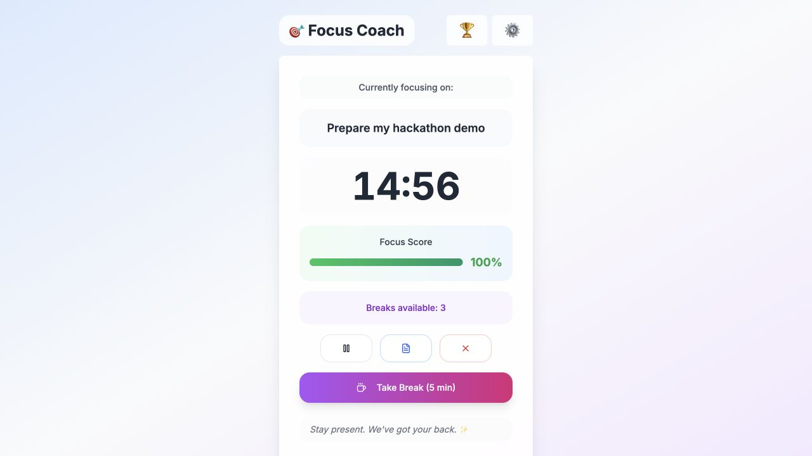

# Demo guide

**[Open Focus Coach](https://v0-new-project-emcec5fbckx.vercel.app/)** · [Back to README](../README.md)

## A short walkthrough

1. **Choose one task.** Enter a short goal on the home screen. The start button becomes available after you enter text.
2. **Set your time.** Choose 15, 25, 30, 45, or 60 minutes. The default shown during review was 25 minutes.
3. **Start focusing.** Select **Start Focus Session**. The workspace displays your task, a countdown, focus score, and remaining breaks.
4. **Explore the session controls.** The pause/play icon controls the timer. The document icon opens **AI Summarization**, where you can paste sample text and request a summary. The × control leads to the session-complete screen.
5. **Take a break or finish.** A five-minute break option is available during a session and on the completion screen. Select **End Focus Session** to return to task setup.
6. **Explore the supporting screens.** Use the trophy icon for the leaderboard and the gear icon for settings.

## Screens

| Screen | Link | What to look for |
| --- | --- | --- |
| Focus workspace | [Home](https://v0-new-project-emcec5fbckx.vercel.app/) | Task entry, duration, session timer, focus feedback, summary panel, and breaks. |
| Preferences | [Settings](https://v0-new-project-emcec5fbckx.vercel.app/settings) | Pomodoro/document modes, summarization and detection toggles, idle reminder options, daily break limits, distracting sites, and themes. |
| Social progress | [Leaderboard](https://v0-new-project-emcec5fbckx.vercel.app/leaderboard) | Weekly challenge, focus totals, streaks, and distraction-time rankings. |

## Verification notes

Reviewed in a desktop browser on **November 12, 2026**, using a sample task and non-sensitive sample text.

| Area | Observed behavior |
| --- | --- |
| Task setup | Empty task disabled the start button; entering a task enabled it. All five duration choices were visible. |
| Focus session | A 15-minute session started and the countdown advanced. The pause control stopped the timer. |
| Summarization | The panel accepted sample text, showed a loading state, and returned a summary. The provider and summarization method are unverified. |
| Completion | The × control displayed a session-complete screen with a score, break option, and end-session control. This happened before the countdown reached zero. |
| Breaks | The five-minute break flow was checked from the completion screen; a break countdown and reduced allowance were displayed. |
| Supporting screens | Settings and leaderboard routes loaded and displayed the options described above. |

## Prototype limits

- The original source is absent from this repository, so dependencies, architecture, data storage, and external integrations cannot yet be inspected or reproduced locally.
- Feature names in the interface describe the prototype experience. They do not establish that an AI service, browser extension, or system-wide site blocker is connected.
- The leaderboard shows named entries and statistics. Treat these as demonstration data until persistence and multi-user behavior are verified.
- Focus scores are prototype feedback; the scoring method and accuracy have not been evaluated.
- Long-running timer completion, every settings toggle, and mobile layouts were not comprehensively tested in this review.

See [project notes](PROJECT_NOTES.md) for the original design goals and next development steps.
